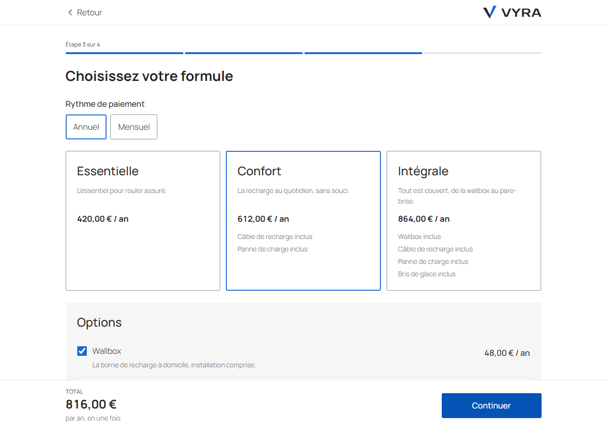
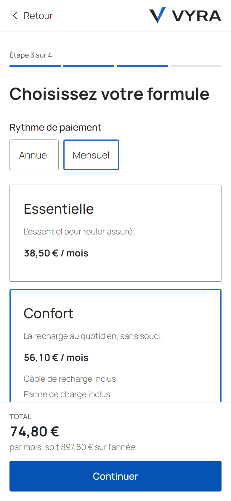
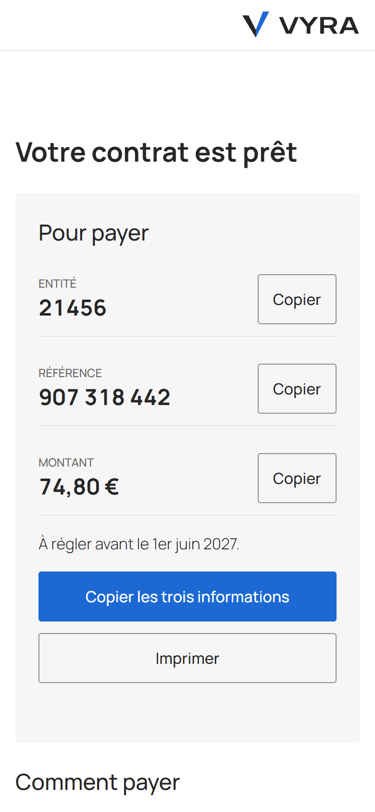

# VYRA Assurance, parcours de souscription BMW électrique

```bash
npx serve .
```

Puis ouvrir http://localhost:3000 (français) ou http://localhost:3000/?lang=en (anglais). Testé depuis une copie propre du dépôt.

Exercice technique Beloy. Sur la page de commande d'une BMW électrique, le client souscrit une assurance qui démarre le jour de la livraison : le véhicule, mais aussi la wallbox, le câble, la batterie, le bris de glace et la panne de charge. L'assureur Ardenne tarifie et émet le contrat. Le parcours doit ressembler à un produit BMW.

**HTML, CSS et JavaScript natifs · modules ES · aucun framework, aucun build, aucune dépendance** · mobile d'abord · thème clair et sombre · FR / EN · 201 tests



<table><tr>
  <td width="33%"></td>
  <td width="33%"></td>
  <td width="33%"></td>
</tr></table>

*Formules en mensuel · référence de paiement · refus de l'assureur (permis de moins de 2 ans), sans code d'erreur.*

<details>
<summary>Autres façons de lancer</summary>

Un serveur est nécessaire, parce que le navigateur refuse de charger des modules ES ouverts en `file://`. N'importe quel serveur statique fait l'affaire.

```bash
python3 -m http.server 8000      # macOS / Linux → http://localhost:8000
py -m http.server 8000           # Windows, si Python est installé
npx.cmd serve .                  # Windows PowerShell, si les scripts npx sont bloqués
```

</details>

<details>
<summary>Pour la démo</summary>

- **Thème sombre** : il suit le réglage du système. Sinon : DevTools → Ctrl+Shift+P → « Rendering » → *Emulate CSS prefers-color-scheme: dark*.
- **Anglais** : ajouter `?lang=en` à l'adresse.
- **Refus de l'assureur** : à l'écran Conducteur, un permis de moins de 2 ans ou 3 sinistres.
- **Mobile** : DevTools → Ctrl+Shift+M.

</details>

## Les 6 écrans

| # | Écran | Ce qu'il fait |
|---|---|---|
| 1 | **Landing** | Ce que couvre l'offre, prix « à partir de 38,50 € par mois » (texte du fichier de langue, montant passé par le formateur), bouton Commencer |
| 2 | **Véhicule** | Modèle pré-rempli depuis la commande (i4, 59 590,00 €), modifiable ; date de livraison, qui doit être dans le futur |
| 3 | **Conducteur** | Date de naissance (18 ans minimum), permis, sinistres sur 3 ans, kilométrage, code postal, stationnement, recharge |
| 4 | **Formules** | Annuel / mensuel, 3 formules côte à côte, 5 options, total en direct. Rien n'est sélectionné à l'ouverture et Continuer reste désactivé tant qu'il n'y a pas de prix |
| 5 | **Récapitulatif** | Réponses relues avec « Modifier » par section, nom et coordonnées, 3 documents précontractuels (liens factices), 3 consentements |
| 6 | **Paiement** | Entité, référence (groupée par 3 chiffres) et montant, chacun copiable, ou les trois d'un coup. Impression, échéance, marche à suivre, numéro de contrat |

Un seul objet `state` ([`js/state.js`](js/state.js)) porte toutes les réponses, avec **les noms de champs de l'API** : la requête se construit sans conversion. Chaque écran est une fonction qui renvoie un élément DOM, et `main.js` remplace le contenu de `#app` à chaque étape. Il n'y a pas de routeur ni de `localStorage`, parce que le brief ne demande pas de survivre à un rechargement.

## La marque

Relevée à la main sur bmw.fr avec les DevTools d'Edge : CSS Overview pour la palette, Styles et Computed pour les composants, `:hov` pour les survols. Le site d'assurance de BMW n'a pas été consulté. Chaque valeur, avec où et comment elle a été trouvée, est dans [`NOTES.md`](NOTES.md).

| Élément | Relevé sur bmw.fr | Dans le flow |
|---|---|---|
| Palette | Monochrome, un seul accent `#1c69d4` | 11 couleurs nommées par rôle : `--color-text`, `--color-accent`… |
| Police | BMW Type Next (sous licence) | **Manrope** : formes larges et carrées, 4 graisses |
| Texte courant | Graisse **300** : 1 618 occurrences contre 107 en 500 | `body` en `--font-weight-light` |
| Échelle typo | Variables `--headline-*`, `--body-*` sur `:root`, palier à 768px | Reprise telle quelle : 6 tailles, 2 paliers |
| Bouton | 52px de haut, rayon 3px, graisse 500, pleine largeur sur mobile | `--control-height`, `--radius-1` |
| Contour | `box-shadow: inset`, pas de `border` | Idem : la sélection n'agrandit jamais l'élément |
| Champ | Bordure 1px `#8e8e8e`, seule la couleur change au focus | Idem |
| Ombre au survol | `0 4px 12px #00000029` (stock locator) | `--shadow-card-hover` |

**Thème sombre** : il n'existe pas sur bmw.fr et a été inventé en restant BMW. Fond `#121212`, texte `#e6e6e6`, même bleu. Les contrastes sont vérifiés sur le fond **et** sur les surfaces.

**Quand BMW contredit AA, AA gagne** :
- en sombre, la bordure des champs passe de `#8e8e8e` à `#6e6e6e` (3:1, WCAG 1.4.11) ;
- le focus passe à `#4d8fe6` et le rouge d'erreur à `#ff6b6b` ;
- le bleu n'est jamais une couleur de texte (3,6:1 sur fond sombre) : les liens restent de la couleur du texte et soulignés.

**Logo** : un V dont la branche droite monte comme une coche, suivi de « VYRA ». Pas de roundel. Le fichier ne contient aucune couleur : il prend `--color-text` et `--color-accent`.

## Structure : changer un token change tout le flow

```
styles/tokens.css    toutes les valeurs de la marque, thème clair et sombre (88 lignes)
styles/base.css      les composants, uniquement en var(--…)
i18n/fr.json, en.json  tous les textes, 158 clés, les mêmes des deux côtés
js/format.js         le seul formateur des montants et des dates (Intl)
js/state.js          l'état du wizard et la navigation
js/api.js            client de l'API Ardenne ; USE_STUB bascule stubs / vrai serveur
js/i18n.js           chargement de la langue et t("flow.cover.title", { price })
js/dom.js, form.js, layout.js   création d'éléments, champs et validation, cadre commun
js/screens/          un module par écran
assets/              logo et favicon
tests/               tests unitaires et de bout en bout
```

Les règles de la maison et où elles vivent :

| Règle | Comment elle est tenue | Vérifiée par |
|---|---|---|
| 1. Un seul fichier de tokens | `base.css` ne contient aucune couleur et aucune taille en dur. Trois exceptions sont listées et justifiées : condition `@media`, `visually-hidden`, `reduced-motion` | `tokens.test.js` |
| 2. Textes par clé, FR et EN | Clés à plat, mêmes marqueurs `{…}` des deux côtés, aucune clé orpheline | `copy.test.js` |
| 3. Un seul formateur | `formatPrice(centimes, devise)` : division par 100 au moment d'afficher, jamais avant | `format.test.js` |
| 4. AA, clavier, focus visible | 26 paires de couleurs calculées, focus en anneau `--color-focus`, focus déplacé sur le `<h1>` à chaque écran | `tokens.test.js`, `layout.test.js` |
| 5. Pas d'intégration de paiement | Référence à payer depuis la banque ou un distributeur | — |
| 6. Aucun code visible | `errorPanel()` : un titre, une phrase, une action ; le code part dans la console | `errors.test.js` |
| 7. Chaque attente a un état | Squelette, `aria-busy`, spinner dans le bouton, places réservées, `scrollbar-gutter: stable` | `layout.test.js` |

### Rebrander en 20 minutes

1. `styles/tokens.css` : couleurs, rayon, ombres, police. Le flow et le logo suivent.
2. `index.html` : le lien Google Fonts de la nouvelle police.
3. `assets/favicon.svg` : deux couleurs à recopier à la main. C'est la seule exception à la règle 1, parce que la favicon s'affiche hors de la page et ne lit pas les tokens. Un test vérifie qu'elle reste synchronisée.
4. `i18n/*.json` : `flow.brand.name` et les textes qui citent BMW.
5. `npm test` : il vérifie que les nouveaux contrastes passent AA.

## Exactitude : le total et l'API

- **Montants en centimes entiers**, comme l'API, du devis jusqu'au total. Ils ne sont divisés par 100 que dans `formatPrice`. Il ne peut donc pas y avoir d'erreur d'arrondi.
- **Annuel et mensuel viennent tous deux de l'API** : le mensuel n'est jamais recalculé à partir de l'annuel (la doc l'interdit, payer en mensualités coûte plus cher). En mensuel, le total précise « soit 897,60 € sur l'année », comme le fait la doc.
- **Total = formule + options cochées**. Une option incluse est cochée, grisée, marquée « Inclus » et jamais comptée. En changeant de formule, les options devenues incluses sont retirées de la sélection (la doc dit de ne pas les envoyer).
- **Exemple chiffré de la doc retrouvé** : confort + Wallbox, Batterie, Bris de glace = **816,00 €** par an ou **74,80 €** par mois. Les tests vérifient aussi les 96 combinaisons possibles.
- **Stubs tirés de la doc** : ils renvoient exactement ses exemples, avec un délai de 900 ms pour que l'attente soit visible. Ils appliquent ses règles d'éligibilité (`422 driver_ineligible`) et de consentement (`422 consent_required`). Le contrat recalcule le montant à partir de la sélection réelle.
- **Une réponse change** (véhicule, conducteur) : le devis et la sélection sont effacés et un nouveau tarif est demandé. Si le client quitte l'écran pendant un appel, la réponse tardive est ignorée.
- **Devis expiré ou introuvable** (`409`, `404`) : un nouveau devis est demandé et la formule choisie est conservée.

## Tests

```bash
npm install          # une seule dépendance, et seulement pour les tests de bout en bout (puppeteer-core)
npm test             # 127 tests unitaires, Node seul, 0,2 s
npm run test:e2e     # 74 tests de bout en bout dans un vrai navigateur, ~2,5 min
```

L'app elle-même n'a aucune dépendance. Les tests unitaires utilisent seulement `node:test`, le lanceur de tests intégré à Node. Les tests de bout en bout pilotent l'Edge ou le Chrome **déjà installé** sur la machine ; on peut en imposer un avec `CHROME_PATH`.

| Fichier | Ce qu'il vérifie |
|---|---|
| `unit/copy.test.js` | Règle 2 : mêmes clés FR / EN, mêmes marqueurs, aucune clé manquante ou orpheline, aucun texte en dur dans les écrans |
| `unit/tokens.test.js` | Règle 1 : aucune valeur en dur, aucun token mort. Règle 4 : contraste AA calculé pour chaque paire dans les deux thèmes. Favicon synchronisée avec les tokens |
| `unit/format.test.js` | Montants FR / EN, espaces insécables, « 1er juin » sans « 11er », pas de décalage de fuseau horaire |
| `unit/i18n.test.js` | `t()` : marqueurs, clé manquante, fichier de langue absent |
| `unit/state.test.js` | Navigation bornée, rien de sélectionné au départ, noms de champs identiques à ceux de l'API |
| `unit/api.test.js` | Stubs identiques aux exemples de la doc (`tests/fixtures/api-doc.js`), éligibilité au jour près, montant du contrat, URL de l'API écrite à un seul endroit |
| `unit/total.test.js` | Exemple chiffré de la doc, options incluses, et les 96 combinaisons formule × options × rythme |
| `unit/helpers.test.js` | Format de date des champs, téléphone français → `+33…`, référence groupée par 3 |
| `e2e/flow.test.js` | Parcours complet, bascule annuel / mensuel sur les vrais chiffres, presse-papiers, anglais |
| `e2e/errors.test.js` | Refus de l'assureur sans code à l'écran (code dans la console), validation champ par champ, focus sur le premier champ en erreur, réponse tardive ignorée |
| `e2e/layout.test.js` | Aucun débordement à 320, 375, 768, 1024 et 1280 px, cibles tactiles ≥ 44px, titre et barre d'action immobiles, clavier, focus visible, thèmes, « un token change tout » |

**Ce que les tests ont trouvé** :
- le champ téléphone refusait `+33 6 12 34 56 78` (corrigé) ;
- pendant le chargement, le squelette fait 208px de haut contre 292px pour une vraie carte, donc le contenu saute de 84px à l'arrivée du devis. Ce n'est pas encore corrigé : le test est marqué « à faire ».

## Ce qui est flou ou faux dans le brief

La liste complète (15 points) est dans [`NOTES.md`](NOTES.md). Les principaux :

- **Aucune franchise dans l'API**, alors que tous les parcours d'assurance comparés l'affichent : le client choisit sa formule sans la connaître.
- **Paiement par entité + référence au distributeur** : c'est le format Multibanco (Portugal), qui n'existe pas tel quel en France.
- **`500` « safe to retry once »** : c'est risqué sur `POST /contracts`, qui pourrait émettre deux contrats, et l'idempotence n'est pas documentée.
- **Le devis d'exemple expire le 21/05/2027**, avant la livraison du 04/06/2027.
- **« Rien de sélectionné à l'ouverture »** : rien ne dit si cela vaut aussi pour annuel / mensuel. Appliqué à la lettre.
- **« Pré-rempli depuis la commande »** : aucun objet commande n'est fourni, et le prix ne change pas quand on change de modèle.

## Pas fait, et avec un jour de plus

- Corriger la taille du squelette de l'écran Formules (le test existe déjà).
- Un vrai mock serveur qui respecte le contrat : `USE_STUB = false` est prêt dans `api.js`. Il permettrait de tester `409`, `500` et la coupure réseau, que le stub ne sait pas renvoyer.
- Prix du véhicule mis à jour au changement de modèle.
- Mention « première mensualité » sur le montant mensuel.
- Audit Lighthouse de chaque écran.

## Travail avec l'IA

[`NOTES.md`](NOTES.md) trace chaque décision avec l'option écartée, ce que l'IA a écrit et ce que j'ai dû corriger ou refuser. Il a servi de base au PDF de rendu [`rendu.pdf`](rendu.pdf). Le brief et la documentation de l'API sont dans [`docs/`](docs/).
