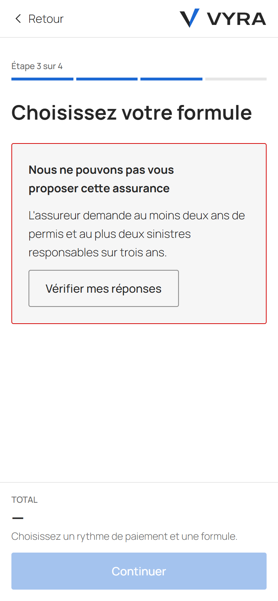

# VYRA Insurance, enrollment flow for BMW electric cars

```bash
npx serve .
```

Then open http://localhost:3000 (French) or http://localhost:3000/?lang=en (English). Tested from a clean copy of the repository.

Beloy take-home exercise. On the order page of an electric BMW, the customer takes out insurance that starts on delivery day. It covers the car, the wallbox, the charging cable, battery degradation, glass breakage and running out of charge. The carrier, Ardenne, prices and issues the contract. The flow has to feel like a BMW product.

**Vanilla HTML, CSS and JavaScript · ES modules · no framework, no build step, no dependencies** · mobile first · light and dark themes · FR / EN · 209 tests · Lighthouse 100


<table><tr>
  <td width="33%"></td>
  <td width="33%"></td>
  <td width="33%"></td>
</tr></table>

*Packages paid monthly · payment reference · carrier refusal (licence held under two years), with no error code on screen. The flow is in French by default.*

<details>
<summary>Other ways to run it</summary>

A server is needed because browsers refuse to load ES modules from `file://`. Any static server works.

```bash
python3 -m http.server 8000      # macOS / Linux → http://localhost:8000
py -m http.server 8000           # Windows, if Python is installed
npx.cmd serve .                  # Windows PowerShell, if npx scripts are blocked
```

</details>

<details>
<summary>Demo tips</summary>

- **Dark theme**: follows the system setting. Otherwise: DevTools → Ctrl+Shift+P → "Rendering" → *Emulate CSS prefers-color-scheme: dark*.
- **English**: add `?lang=en` to the URL.
- **Carrier refusal**: on the Driver screen, a licence held under two years, or 3 claims.
- **Mobile**: DevTools → Ctrl+Shift+M.

</details>

## The 6 screens

| # | Screen | What it does |
|---|---|---|
| 1 | **Landing** | What the cover includes, a "from €38.50 a month" price (text from the copy file, amount through the formatter), a Start button |
| 2 | **Vehicle** | Model pre-filled from the order (i4, €59,590.00) and editable: the list price follows the model (fictional but plausible prices, i4 from the API docs); delivery date, which must be in the future |
| 3 | **Driver** | Date of birth (18 or over), licence date, claims over 3 years, annual mileage, postcode, overnight parking, charging location |
| 4 | **Packages** | Annual / monthly switch, 3 packages side by side, 5 add-ons, live total. Nothing is selected on arrival, and Continue stays disabled until there is a price |
| 5 | **Summary** | Answers read back with "Edit" per section, name and contact details, 3 pre-contractual documents (dummy links), 3 consents |
| 6 | **Payment** | Entity, reference (grouped in threes) and amount, labelled "First instalment" when paying monthly (the API docs say so). Each is copyable, or all three at once. Print, due date, how to pay, policy number |

A single `state` object ([`js/state.js`](js/state.js)) holds every answer, using **the API's field names**, so requests are built without any renaming. Each screen is a function that returns a DOM element, and `main.js` replaces the contents of `#app` on every step. There is no router and no `localStorage`, because the brief does not require surviving a page reload.

## The brand

Extracted by hand from bmw.fr with Edge DevTools: CSS Overview for the palette, Styles and Computed for the components, `:hov` for hover states. BMW's insurance site was not consulted. Every value, with where and how it was found, is logged in [`NOTES.md`](NOTES.md) (in French).

| Element | Found on bmw.fr | In the flow |
|---|---|---|
| Palette | Monochrome, a single accent `#1c69d4` | 11 colours named by role: `--color-text`, `--color-accent`… |
| Typeface | BMW Type Next (licensed) | **Manrope**: wide, squared shapes, 4 weights |
| Body text | Weight **300**: 1,618 occurrences against 107 at 500 | `body` uses `--font-weight-light` |
| Type scale | `--headline-*` and `--body-*` variables on `:root`, one breakpoint at 768px | Kept as is: 6 sizes, 2 steps |
| Button | 52px high, 3px radius, weight 500, full width on mobile | `--control-height`, `--radius-1` |
| Outline | `box-shadow: inset`, not `border` | Same: selecting an element never makes it bigger |
| Input | 1px `#8e8e8e` border, only the colour changes on focus | Same |
| Hover shadow | `0 4px 12px #00000029` (stock locator) | `--shadow-card-hover` |

**Dark theme**: bmw.fr has none, so it was invented while staying BMW. Background `#121212`, text `#e6e6e6`, the same blue. Contrast is checked against the background **and** the surfaces.

**When BMW conflicts with AA, AA wins**:
- in dark mode, the input border goes from `#8e8e8e` to `#6e6e6e` (3:1, WCAG 1.4.11);
- the focus ring goes to `#4d8fe6` and the error red to `#ff6b6b`;
- blue is never used as a text colour (3.6:1 on the dark background), so links keep the text colour and an underline.

**Logo**: a V whose right stroke rises like a tick, followed by "VYRA". No roundel. The file contains no colour: it takes `--color-text` and `--color-accent`.

## Structure: changing a token changes the whole flow

```
styles/tokens.css    every brand value, light and dark themes (88 lines)
styles/base.css      the components, only in var(--…)
i18n/fr.json, en.json  every string, 158 keys, the same in both files
js/format.js         the single formatter for amounts and dates (Intl)
js/state.js          wizard state and navigation
js/api.js            Ardenne API client; USE_STUB switches between stubs and a real server
js/i18n.js           loads the language and t("flow.cover.title", { price })
js/dom.js, form.js, layout.js   element creation, fields and validation, shared frame
js/screens/          one module per screen
assets/              logo and favicon
tests/               unit and end-to-end tests
```

The house rules and where they live:

| Rule | How it is met | Checked by |
|---|---|---|
| 1. One token file | `base.css` has no hard-coded colour or size. Three exceptions are listed and justified: `@media` conditions, `visually-hidden`, `reduced-motion` | `tokens.test.js` |
| 2. Strings by key, FR and EN | Flat keys, the same `{…}` placeholders on both sides, no orphan key | `copy.test.js` |
| 3. One formatter | `formatPrice(minorUnits, currency)`: divides by 100 at display time, never before | `format.test.js` |
| 4. AA, keyboard, visible focus | 26 colour pairs computed, focus ring in `--color-focus`, focus moved to the `<h1>` on every screen | `tokens.test.js`, `layout.test.js` |
| 5. No payment integration | A reference paid from the customer's bank or a cash machine | — |
| 6. No visible error code | `errorPanel()`: a title, a sentence, an action; the code goes to the console | `errors.test.js` |
| 7. Every wait has a state | Skeleton built like the final screen (the real frequency switch, disabled, and ghost cards with the real card classes), `aria-busy`, spinner inside the button, reserved space, `scrollbar-gutter: stable` | `layout.test.js` |

### Rebranding in 20 minutes

1. `styles/tokens.css`: colours, radius, shadows, typeface. The flow and the logo follow.
2. `index.html`: the Google Fonts link for the new typeface.
3. `assets/favicon.svg`: two colours to copy by hand. This is the only exception to rule 1, because a favicon is drawn outside the page and cannot read the tokens. A test checks that it stays in sync.
4. `i18n/*.json`: `flow.brand.name` and the strings that mention BMW.
5. `npm test`: checks that the new contrasts still pass AA.

## Accuracy: the total and the API

- **Amounts are integers in minor units**, as in the API, from the quote to the total. They are divided by 100 only in `formatPrice`, so there can be no rounding error.
- **Annual and monthly prices both come from the API**: monthly is never derived from annual (the API documentation forbids it, because paying in instalments costs more). In monthly mode the total adds "i.e. €897.60 over the year", as the documentation does.
- **Total = package + ticked add-ons**. An included add-on is ticked, greyed out, labelled "Included" and never counted. When the customer switches package, add-ons that become included are removed from the selection, because the documentation says not to send them.
- **The documentation's worked example is reproduced**: comfort + Wallbox, Battery, Glass = **€816.00** a year or **€74.80** a month. The tests also cover all 96 possible combinations.
- **Stubs built from the documentation**: they return its examples exactly, with a 900 ms delay so the waiting state is visible. They apply its eligibility rule (`422 driver_ineligible`) and its consent rule (`422 consent_required`). The contract stub recomputes the amount from the actual selection.
- **When an answer changes** (vehicle, driver), the quote and the selection are cleared and a new price is requested. If the customer leaves the screen during a call, the late response is ignored.
- **Expired or unknown quote** (`409`, `404`): a new quote is requested and the chosen package is kept.

## Tests

```bash
npm install          # a single dependency, used only by the end-to-end tests (puppeteer-core)
npm test             # 132 unit tests, Node only, 0.2 s
npm run test:e2e     # 77 end-to-end tests in a real browser, ~2.5 min
```

The app itself has no dependencies. Unit tests use only `node:test`, Node's built-in test runner. End-to-end tests drive the Edge or Chrome **already installed** on the machine; set `CHROME_PATH` to force a specific one.

| File | What it checks |
|---|---|
| `unit/copy.test.js` | Rule 2: same FR / EN keys, same placeholders, no missing or orphan key, no hard-coded string in the screens |
| `unit/tokens.test.js` | Rule 1: no hard-coded value, no dead token. Rule 4: AA contrast computed for every pair in both themes. Favicon in sync with the tokens |
| `unit/format.test.js` | FR / EN amounts, non-breaking spaces, French "1er juin" without "11er", no time-zone shift |
| `unit/i18n.test.js` | `t()`: placeholders, missing key, missing language file |
| `unit/state.test.js` | Bounded navigation, nothing selected at the start, field names identical to the API's |
| `unit/api.test.js` | Stubs identical to the documentation's examples (`tests/fixtures/api-doc.js`), eligibility to the exact day, contract amount, API URL written in a single place |
| `unit/total.test.js` | The documentation's worked example, included add-ons, and all 96 package × add-on × frequency combinations |
| `unit/vehicle.test.js` | Price per model: the 6 models the API accepts, i4 equal to the API docs, integers in minor units, a consistent range |
| `unit/helpers.test.js` | Date format of the fields, French phone number → `+33…`, reference grouped in threes |
| `e2e/flow.test.js` | Full flow, price per model, annual / monthly switch on the real figures, "First instalment" label, clipboard, English |
| `e2e/errors.test.js` | Carrier refusal with no code on screen (code in the console), field-by-field validation, focus on the first invalid field, late response ignored |
| `e2e/layout.test.js` | No overflow at 320, 375, 768, 1024 and 1280 px, touch targets ≥ 44px, title, action bar and cards never move while the quote loads, keyboard, visible focus, themes, "one token changes everything" |

## Lighthouse

Audited in Lighthouse's *user flow* mode, because only the landing has a URL: a full navigation audit of the landing, then a snapshot of each of the 5 other screens, reached by actually filling the flow. Mobile, light and dark themes.

| | Accessibility | Best practices | SEO | Performance |
|---|---|---|---|---|
| 6 screens × 2 themes | 100 | 100 | 100 | 99 (landing) |

Snapshots do not measure performance, so the landing's navigation audit is the only performance score. Full reports: [`docs/lighthouse/`](docs/lighthouse/) (open the HTML files in a browser).

## Working with AI

[`NOTES.md`](NOTES.md) (in French) logs every decision with the option rejected, what the AI wrote, and what I had to correct or refuse. It was the basis of the submission PDF, [`rendu.pdf`](rendu.pdf).
